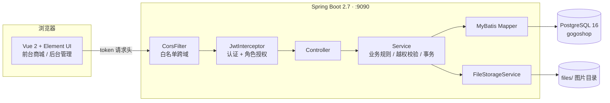
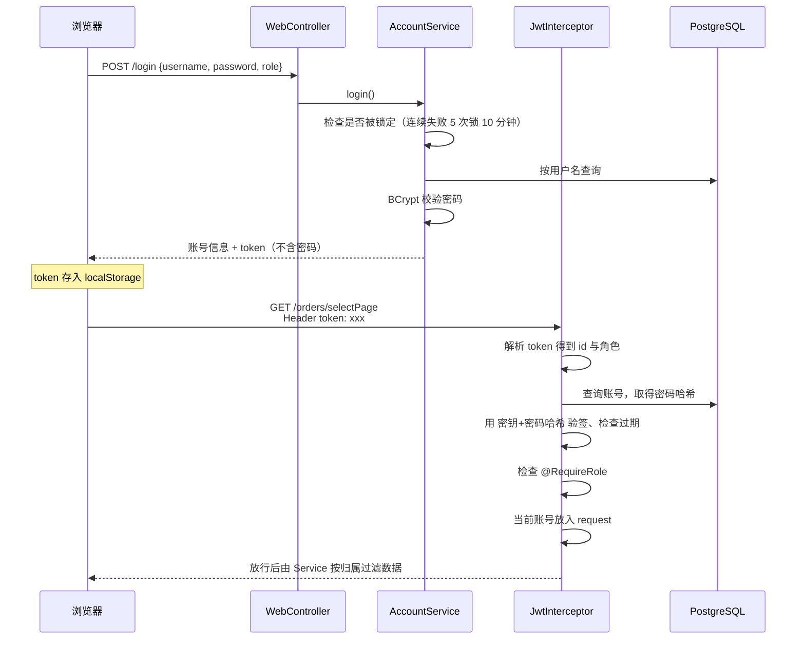
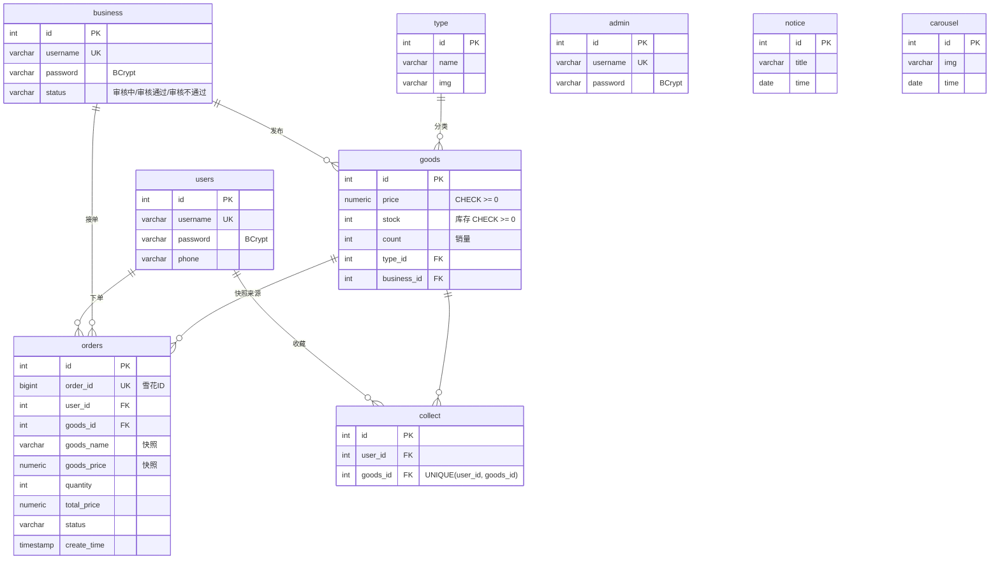
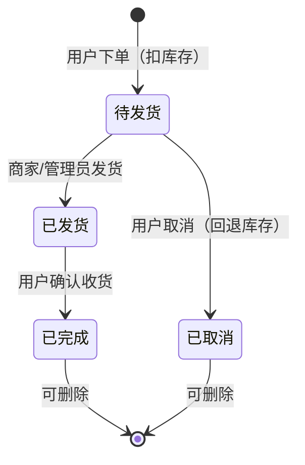

# GOGO购商城 系统架构

## 1. 总体架构

前后端分离的单体应用：Vue 单页应用通过 HTTP + JSON 调用 Spring Boot 后端，后端用 MyBatis 访问 PostgreSQL，上传的图片保存在本地 `files/` 目录。



| 层 | 技术 | 说明 |
|---|---|---|
| 前端 | Vue 2.6、Vue Router 3、Element UI 2、axios | `/front/*` 为用户商城，`/` 下为管理员和商家的后台 |
| 接入层 | CorsFilter、JwtInterceptor | 跨域白名单；所有接口默认需要登录，`@PublicApi` 放行，`@RequireRole` 限制角色 |
| 控制层 | Spring MVC `@RestController` | 只做参数接收和结果包装，统一返回 `Result{code,msg,data}` |
| 业务层 | Spring `@Service` | 数据归属校验、订单状态机、库存扣减事务、密码哈希 |
| 持久层 | MyBatis 3.5 + PageHelper | SQL 写在 `resources/mapper/*.xml`，全部使用 `#{}` 预编译参数 |
| 数据库 | PostgreSQL 16 | 外键、唯一约束、CHECK 约束保证数据一致性 |
| 存储 | 本地磁盘 | 图片文件名由服务端生成，读取时做路径穿越校验 |

## 2. 后端目录结构

```
springboot/src/main/java/com/example
├── common
│   ├── annotation      @PublicApi（无需登录）、@RequireRole（角色限制）
│   ├── config          JwtInterceptor、CorsConfig、WebConfig、GogoshopProperties、SecurityBeans
│   ├── enums           ResultCodeEnum、RoleEnum、StatusEnum（商家审核）、OrderStatusEnum（订单状态机）
│   └── Result          统一返回体
├── controller          11 个 REST 控制器
├── service
│   ├── AbstractAccountService   管理员/商家/用户三类账号的公共逻辑（登录、注册、改密、资料修改）
│   ├── AccountRegistry          按角色分发到对应账号 Service，并负责 token 认证
│   ├── LoginAttemptService      登录失败锁定
│   ├── FileStorageService       图片上传与读取
│   └── Goods/Orders/Collect/... 业务 Service
├── mapper              AccountMapper<T> 泛型接口 + 各表 Mapper
├── entity              实体类（Lombok）
├── exception           CustomException、GlobalExceptionHandler
└── utils/TokenUtils    JWT 签发与校验、获取当前登录账号
```

## 3. 认证与授权

### 3.1 登录与请求认证流程



**token 设计**：载荷为 `用户id-角色`，有效期 2 小时，签名密钥为 `服务端密钥 + 用户密码哈希`。

- 只有服务端密钥的持有者能签发 token；
- 用户修改密码后，之前签发的 token 立即失效；
- token 只从请求头读取，不接受 URL 参数。

### 3.2 两层权限控制

1. **接口层（角色）**：`JwtInterceptor` 读取 `@RequireRole`，角色不匹配返回 `403`。
2. **数据层（归属）**：Service 内校验“这条数据是不是你的”，例如商家只能改自己店铺的商品，用户只能看自己的订单。

### 3.3 权限矩阵

| 资源 | 管理员 ADMIN | 商家 BUSINESS | 用户 USER | 未登录 |
|---|---|---|---|---|
| 登录 / 注册 | ✔（不能注册管理员） | ✔ | ✔ | ✔ |
| 管理员管理 | ✔ | ✘ | ✘ | ✘ |
| 商家 / 用户列表 | ✔ | ✘ | ✘ | ✘ |
| 修改个人资料 | 任意账号 | 仅自己，且不能改审核状态 | 仅自己 | ✘ |
| 分类 / 公告 / 轮播图 写 | ✔ | ✘ | ✘ | ✘ |
| 分类 / 公告 / 轮播图 / 商品 读 | ✔ | ✔ | ✔ | ✘ |
| 商品 增删改 | ✔ | 仅自己店铺，需审核通过 | ✘ | ✘ |
| 下单 | ✘ | ✘ | ✔ | ✘ |
| 订单查看 | 全部 | 本店订单 | 自己的订单 | ✘ |
| 订单发货 | ✔ | 本店订单 | ✘ | ✘ |
| 订单取消 / 确认收货 | ✘ | ✘ | 自己的订单 | ✘ |
| 订单删除 | ✔ | 本店已结束订单 | 自己已结束的订单 | ✘ |
| 收藏 | 查看全部 | 查看本店被收藏记录 | 增删查自己的 | ✘ |
| 上传图片 | ✔ | ✔ | ✔ | ✘ |
| 读取图片 `/files/{name}` | ✔ | ✔ | ✔ | ✔ |
| 删除图片 | ✔ | ✘ | ✘ | ✘ |

## 4. 数据模型



设计要点：

- **订单快照**：下单时把商品名、图片、单价、单位写进订单，商家改价或删除商品不影响历史订单。
- **金额**：数据库用 `NUMERIC`，Java 用 `BigDecimal`，避免浮点误差。
- **订单号**：雪花算法生成 19 位 `BIGINT`。返回给前端时转成字符串，因为 JS 的 Number 只能精确表示 2^53 以内的整数。
- **`users` 表名**：`user` 是 PostgreSQL 保留字，所以普通用户表命名为 `users`。

## 5. 订单状态机



- 状态流转规则集中在 `OrderStatusEnum.canTransitTo()`，有单元测试覆盖；
- 更新状态的 SQL 带旧状态条件（`WHERE id=? AND status=?`），并发重复操作只有一次会成功；
- 下单的扣库存语句是 `UPDATE goods SET stock = stock - ? WHERE id = ? AND stock >= ?`，与插入订单在同一个事务里，库存不足时整体回滚，不会超卖。

## 6. 配置项

所有敏感配置都可以用环境变量覆盖（见 `application.yml`）：

| 环境变量 | 默认值 | 说明 |
|---|---|---|
| `DB_URL` | `jdbc:postgresql://localhost:5432/gogoshop` | 数据库连接 |
| `DB_USERNAME` / `DB_PASSWORD` | `postgres` / `123456` | 数据库账号（仅本地开发默认值） |
| `JWT_SECRET` | 开发用默认值 | **生产环境必须修改** |
| `CORS_ORIGINS` | `http://localhost:8080,http://127.0.0.1:8080` | 允许跨域的前端地址 |
| `FILE_UPLOAD_DIR` | 自动查找项目根目录下的 `files/` | 图片目录 |
| `FILE_BASE_URL` | `http://localhost:9090` | 返回给前端的图片地址前缀 |
